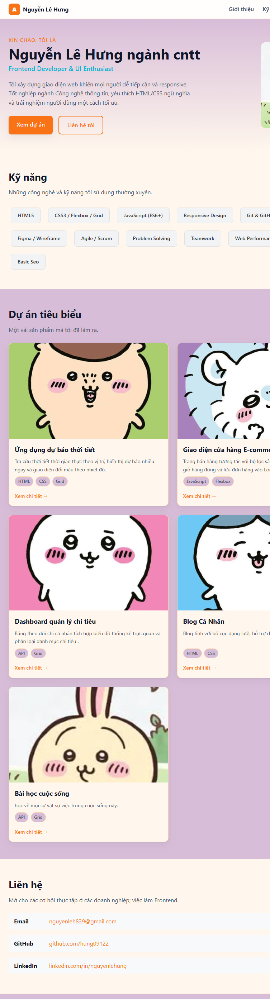
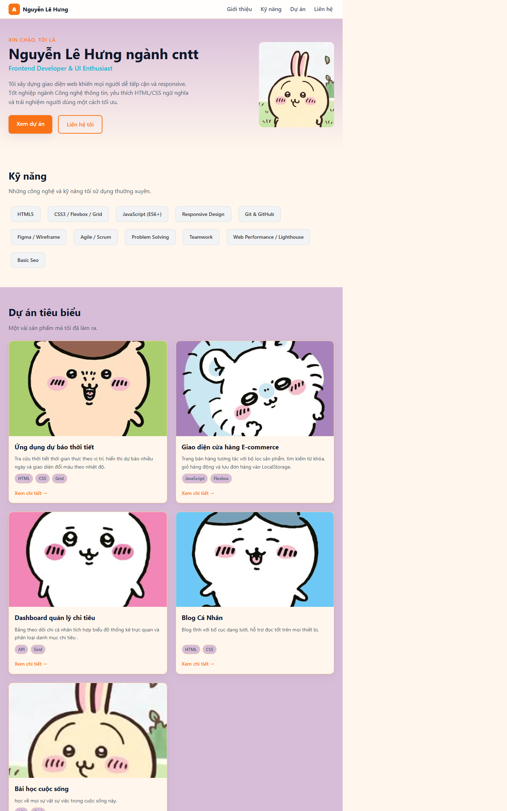

# Báo cáo kiểm thử — Portfolio CV

## 1. Thông tin chung

| Hạng mục | Chi tiết |
|---|---|
| Dự án | Portfolio CV cá nhân Nguyễn Lê Hưng |
| Phiên bản | v1.0 (theo release note) |
| Ngày kiểm thử | 05/11/2026 |
| Loại ứng dụng | Website tĩnh, HTML5 và CSS3 |
| Môi trường kiểm thử | Windows, trình duyệt Chromium tích hợp, mở trang từ tệp cục bộ |
| Kích thước viewport | 375 × 900, 768 × 900 và 1440 × 900 px |
| Phương pháp | Kiểm tra tĩnh mã nguồn và kiểm thử smoke/responsive trên trình duyệt |

## 2. Mục tiêu và phạm vi

Kiểm tra khả năng tải trang, hiển thị nội dung chính, ảnh và CSS; xác nhận các khu vực CV, điều hướng nội bộ, liên hệ và bố cục ở một số kích thước màn hình. Báo cáo cũng ghi nhận các liên kết chưa được cấu hình.

Phạm vi không bao gồm kiểm thử các ứng dụng/dự án được giới thiệu trong portfolio, vì mã nguồn hiện tại chỉ chứa website CV tĩnh. Không thực hiện kiểm thử đa trình duyệt, thiết bị thật, screen reader, tải trọng, bảo mật hoặc kiểm thử triển khai trên máy chủ.

## 3. Tóm tắt kết quả

**Kết luận: Đạt có điều kiện — cần xử lý các liên kết placeholder trước khi phát hành portfolio chính thức.**

| Trạng thái | Số lượng |
|---|---:|
| Đạt | 8 |
| Không đạt | 1 |
| Chưa thực hiện | 3 |

Các chức năng trình bày và bố cục cơ bản hoạt động trong môi trường đã kiểm tra. Một trường hợp không đạt do bảy liên kết vẫn trỏ đến `#`. Một số kiểm thử chuyên sâu chưa được thực hiện nên kết quả không đại diện cho tất cả trình duyệt và thiết bị.

## 4. Chi tiết trường hợp kiểm thử

| ID | Hạng mục | Bước/điều kiện kiểm thử | Kết quả mong đợi | Kết quả ghi nhận | Trạng thái |
|---|---|---|---|---|---|
| TC-01 | Tải trang | Mở `index.html` trong trình duyệt | Trang mở được, có tiêu đề và nội dung chính | Trang mở được; tiêu đề hiển thị “Nguyễn Lê Hưng · Frontend Developer” | Đạt |
| TC-02 | Tải CSS | Kiểm tra giao diện sau khi mở trang | CSS được nạp, các thành phần có bố cục và định dạng | `assets/css/styles.css` được nạp | Đạt |
| TC-03 | Ảnh | Kiểm tra ảnh đại diện và ảnh dự án | Tất cả ảnh tham chiếu tải thành công | 6 ảnh hiển thị; không phát hiện ảnh lỗi trong lần kiểm tra | Đạt |
| TC-04 | Điều hướng và khu vực nội dung | Kiểm tra các mục Giới thiệu, Kỹ năng, Dự án, Liên hệ và đích liên kết nội bộ | Có đủ khu vực và đích tương ứng tồn tại | Cả bốn khu vực có mặt; các đích nội bộ được tìm thấy trong trang | Đạt |
| TC-05 | Danh sách kỹ năng | Kiểm tra danh sách kỹ năng được trình duyệt phân tích | Các mục kỹ năng hiển thị thành danh sách | Hiển thị 11 mục kỹ năng | Đạt |
| TC-06 | Danh sách dự án | Kiểm tra số lượng thẻ và nội dung dự án | Các thẻ dự án và ảnh minh họa hiển thị | Hiển thị 5 thẻ dự án, có tiêu đề, mô tả và ảnh | Đạt |
| TC-07 | Responsive/mobile | Đặt viewport 375 × 900 px | Không xuất hiện cuộn ngang ngoài ý muốn | Chiều rộng tài liệu 360 px, không tràn ngang | Đạt |
| TC-08 | Responsive/tablet và desktop | Đặt viewport 768 × 900 và 1440 × 900 px | Bố cục thích ứng, không xuất hiện cuộn ngang ngoài ý muốn | Không tràn ngang; lưới dự án lần lượt hiển thị 2 và 3 cột | Đạt |
| TC-09 | Liên kết liên hệ và dự án | Kiểm tra URL của các liên kết GitHub, LinkedIn và “Xem chi tiết” | Mỗi liên kết mở đúng hồ sơ hoặc dự án tương ứng | Cả 5 liên kết dự án và 2 liên kết hồ sơ đều có `href="#"` | Không đạt |
| TC-10 | Hành vi tương tác | Thử hover, focus bàn phím, cuộn mượt và thao tác đầy đủ trên các liên kết | Tương tác nhất quán, có thể sử dụng bằng bàn phím | Chưa kiểm thử thao tác thực tế trên trình duyệt | Chưa thực hiện |
| TC-11 | Tương thích và trợ năng | Kiểm tra trình duyệt khác, thiết bị thật và screen reader | Trải nghiệm ổn định trên môi trường mục tiêu và công nghệ trợ năng | Chưa kiểm thử | Chưa thực hiện |
| TC-12 | Phục vụ qua máy chủ | Chạy trang bằng Python hoặc Docker/Nginx và kiểm tra phản hồi | Trang và tài nguyên tải được qua HTTP | Chưa kiểm thử trong báo cáo này | Chưa thực hiện |

### Minh chứng Responsive

Ảnh chụp toàn trang được ghi lại trên trình duyệt Chromium ở các viewport mô phỏng; đây không phải ảnh chụp từ thiết bị vật lý.

**Mobile — 375 × 900 px**

**Tablet — 768 × 900 px**

**Desktop — 1440 × 900 px**

## 5. Vấn đề phát hiện

### BUG-01 — Liên kết dự án và hồ sơ chưa được cấu hình

- **Mức độ:** Trung bình
- **Khu vực:** Phần Dự án và Liên hệ
- **Mô tả:** Năm liên kết “Xem chi tiết” và hai liên kết GitHub/LinkedIn đều trỏ đến `#`, nên không dẫn đến dự án hoặc hồ sơ tương ứng.
- **Bước tái hiện:** Mở phần Dự án hoặc Liên hệ, chọn một trong các liên kết trên.
- **Kết quả hiện tại:** Trình duyệt chỉ điều hướng đến đầu trang hoặc không mở tài nguyên mong muốn.
- **Kết quả mong đợi:** Liên kết mở URL dự án/hồ sơ hợp lệ; nếu chưa có URL, nên hiển thị nội dung không giả dạng liên kết hoạt động.
- **Đề xuất:** Cập nhật các URL thật trong `index.html` trước khi công bố trang.

### OBS-01 — Cấu trúc HTML danh sách kỹ năng cần chuẩn hóa

- **Mức độ:** Thấp
- **Khu vực:** Danh sách kỹ năng trong `index.html`
- **Mô tả:** Thẻ `<li>` của mục Agile/Scrum thiếu thẻ đóng tường minh trước mục tiếp theo; cuối danh sách có thẻ đóng `<li>` dư. Chromium vẫn tự sửa cấu trúc khi phân tích và hiển thị các mục như danh sách phẳng trong lần kiểm tra này.
- **Ảnh hưởng:** Chưa ghi nhận lỗi hiển thị trong Chromium; cấu trúc nguồn không rõ ràng và có thể gây cảnh báo khi chạy HTML validator hoặc khác biệt trong một số công cụ.
- **Đề xuất:** Đóng từng mục `<li>` riêng biệt và kiểm tra lại bằng HTML validator.

## 6. Hạn chế của lần kiểm thử

- Chỉ kiểm tra bằng một Chromium tích hợp, mở trực tiếp từ tệp cục bộ.
- Kiểm tra responsive dựa trên viewport mô phỏng; chưa thử thiết bị thật hoặc browser engine khác.
- Chưa xác minh các URL bên ngoài vì chúng hiện chưa được cấu hình.
- Chưa chạy HTML validator, Lighthouse, kiểm thử screen reader, bảo mật hoặc hiệu năng.
- Chưa kiểm thử các tính năng được mô tả bên trong từng dự án; chúng không thuộc chức năng của website CV hiện tại.

## 7. Khuyến nghị trước khi phát hành

1. Cập nhật hoặc bỏ các liên kết `#` ở dự án, GitHub và LinkedIn.
2. Chuẩn hóa cấu trúc `<li>` của danh sách kỹ năng, sau đó chạy HTML validator.
3. Thực hiện lại TC-09 sau khi cập nhật URL.
4. Bổ sung kiểm thử bàn phím và kiểm tra nhanh trên ít nhất một trình duyệt khác hoặc thiết bị thật.
